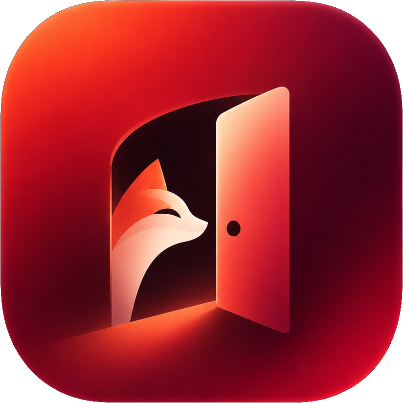

<p align="center"></p>

# Sidedoor

**Any web page, as a JSON endpoint and an agent tool, from one plain-English sentence.**

Plenty of useful data lives behind sites with no API: a college portal, a supplier catalogue, an internal dashboard. Sidedoor takes one sentence ("store the amount next to 'Amount due' as 'amount_due'"). Kane CLI records the browser flow once, and Sidedoor turns the recording into a typed endpoint (`GET /api/fees?student_id=S1002`) and an MCP tool any agent can call. Every call replays the recording and checks the result against a contract built from the first run. When the site changes and a replay breaks the contract, Sidedoor has Kane re-record the flow, checks the new result, replays it once more to prove it, and swaps it in. No human touches it, and Sidedoor has no AI key of its own.

- **Live playback** (real recorded runs, nothing to install): https://getsidedoor.pages.dev (dashboard at `/dashboard`, playground at `/playground`)
- **Demo portal** (the made-up campus site the endpoints read): https://getsidedoor.pages.dev/campus/ (add `?layout=b` to see the redesign)
- **Video** (under 3 minutes): _link added at upload_

Built for the Kane CLI Online Hackathon (TestMu AI).

---

## Install (npx, no clone)

You need **Node 20+** and **[Kane CLI](https://www.npmjs.com/package/@testmuai/kane-cli), signed in with your own account**. Sidedoor runs Kane on your machine, so recordings and repairs spend your Kane credits; replays are free.

```bash
npm install -g @testmuai/kane-cli
```

```bash
kane-cli login
```

Then run any command with npx:

```bash
npx getsidedoor create --name book-price --url https://books.toscrape.com/ --input title="A Light in the Attic" "Click the book whose title is {{title}} on the home page, then store its price as 'price' and its stock availability text as 'availability'."
```

```bash
npx getsidedoor call book-price --title "A Light in the Attic"
```

```bash
npx getsidedoor serve
```

`serve` opens the HTTP API on http://localhost:3030, with the dashboard at `/dashboard` and the playground at `/playground`. Endpoints live in `~/.sidedoor/` (created on first run), so every command finds the same ones wherever you run it. Set `SIDEDOOR_HOME` to use another folder. A fresh install starts with no endpoints; the six example endpoints are in the repo (`endpoints/`), and three of them read the demo portal, which only runs from a clone.

Add it to any MCP client (Claude Code, Claude Desktop, Cursor, Codex...):

```json
{ "mcpServers": { "sidedoor": { "command": "npx", "args": ["-y", "getsidedoor", "mcp"] } } }
```

For Claude Code, the same in one line:

```bash
claude mcp add sidedoor -- npx -y getsidedoor
```

The agent starts with `create_endpoint`, `repair_endpoint` and `list_endpoints`, and gets one typed tool per endpoint it (or you) creates.

### `/sidedoor` in Claude Code (plugin)

The plugin bundles the MCP server and a `/sidedoor` command. Install it from inside Claude Code:

```
/plugin install sidedoor --marketplace himxsh/Sidedoor
```

(On Claude Code before 2.1.275, run `/plugin marketplace add himxsh/Sidedoor` first, then `/plugin install sidedoor@sidedoor`.)

Then, while chatting:

```
/sidedoor go through https://books.toscrape.com/ and get the price and stock of "Tipping the Velvet"
/sidedoor book-price "Sapiens"
/sidedoor fix book-price
/sidedoor list
```

The first form drafts an endpoint: a name, `{{inputs}}` taken from the parts of your task that vary, and a direct sentence. It shows you the draft and the one-time cost, has Kane record it, and answers your question. After that, the same request is a replay of the saved endpoint. If an endpoint already covers your request, `/sidedoor` calls it instead of recording again. Endpoints that submit forms are never recorded or repaired without your yes. The plugin lives in `plugin/`.

If `kane-cli` is not on your `PATH`, create, call and repair return an error that says how to install it (or set `SIDEDOOR_KANE_BIN` to the binary).

## Run the demo from the repo (about 2 minutes)

You need Node 20+ and [Kane CLI](https://www.npmjs.com/package/@testmuai/kane-cli), signed in (`kane-cli login`). Inside the clone, Sidedoor uses the repo folder itself instead of `~/.sidedoor`.

```bash
git clone https://github.com/himxsh/Sidedoor.git
```

```bash
cd Sidedoor && npm install
```

```bash
npm start
```

That starts the demo Campus Portal on http://localhost:4400 and Sidedoor on http://localhost:3030 (dashboard at `/dashboard`, playground at `/playground`, API, live event stream). The repo already includes six recorded endpoints, so calls work straight away:

```bash
curl 'localhost:3030/api/fees?student_id=S1002'
```

```json
{ "endpoint": "fees", "ok": true, "verified": true,
  "data": { "amount_due": "₹18,000", "due_date": "2026-12-05" },
  "durationMs": 26105, "cached": false, "health": "healthy",
  "evidence": { "screenshot": "shots/fees-hldrtik3.png" } }
```

Make your own:

```bash
npx tsx src/cli.ts create --name book-price --url https://books.toscrape.com/ --input title="A Light in the Attic" "Click the book whose title is {{title}} on the home page, then store its price as 'price' and its stock availability text as 'availability'."
```

Or use the **Create an endpoint** form in the dashboard.

### Give it to an agent (MCP)

`.mcp.json` is already in the repo root, so Claude Code picks it up in this folder. To point another MCP client at the repo's endpoints (instead of `npx -y getsidedoor mcp`, which uses `~/.sidedoor`):

```json
{ "mcpServers": { "sidedoor": { "command": "npx", "args": ["tsx", "src/cli.ts", "mcp"], "env": { "SIDEDOOR_HOME": "/path/to/Sidedoor" } } } }
```

The agent gets:
- one typed tool per endpoint (`quotes`, `fees`, `notices`, `book_price`, `leave_request`, `top_tag`);
- `create_endpoint`, to make itself a new tool from a sentence;
- `repair_endpoint`, to fix a broken one with a sharper sentence;
- `list_endpoints`.

`evidence/mcp/claude-session.json` is a real headless Claude Code session (trimmed to its tool calls and answers) that called `quotes` and then created `book-price` on its own.

### Command line

| Command | What it does |
|---|---|
| `sidedoor create --name X --url URL [--input k=sample]... [--action] "sentence"` | Kane records once, builds the contract, proves one replay |
| `sidedoor call X [--k v]... [--no-cache]` | Replays and returns verified JSON (with guard and repair) |
| `sidedoor repair X "sharper sentence"` | Re-records with a new sentence, checked and verified |
| `sidedoor list` / `serve [--port]` / `mcp` | List endpoints, run the HTTP server and dashboard, run the MCP server |

(Installed: `npx getsidedoor …`. From the repo: `npx tsx src/cli.ts …`; `npm install` also builds `dist/` for the `sidedoor` bin.)

---

## What Kane does (and what Sidedoor adds)

| Step | Kane CLI | Sidedoor |
|---|---|---|
| Create | `kane-cli run "<objective>" --agent --headless` records the flow and saves a test file | Writes the objective from URL + sentence, maps `{{inputs}}` to Kane variables, strips the `variables:` block Kane saves (it would override later inputs), and builds a **contract** (field names and types) from the stored values. One proving replay before the endpoint goes live. |
| Call | `kane-cli testmd run <test> --variables … --no-adaptive-heal` replays the recording | Reads `run_end.context.variables`, checks every value against the contract, caches reads for 5 minutes, queues browsers (2 at a time), locks per endpoint, keeps Kane's screenshot as evidence |
| Guard | `testmd run --author` re-authors every step against the current page | Runs when a replay fails **or** "passes" with values that break the contract. Re-records, checks, then replays once more to verify before swapping in. If the first re-record fails, Sidedoor takes the fix Kane proposed in its own failure remark and retries with it. Old recordings are backed up and restored on failure. |
| Build hook | `testmd run` of two UI tests | A Claude Code `PostToolUse` hook: every edit to the dashboard or portal replays Kane tests against them. On failure the agent is blocked and shown Kane's remark. |

### The closed loop, on a real run

`notices` was recorded on layout A of the portal. Then the portal switched to layout B, where the home page is a dashboard and notices sit behind an **Announcements** link. The next call, from the dashboard's try-it box:

1. **Replay**: Kane exits 0 ("passed"), but `title` and `date` are the string `"false"`. The **contract** catches it: "boolean where text was expected".
2. **Re-record** with `--author`: fails. Kane's remark says to open Announcements first.
3. **Retry with Kane's own fix**, "Open Announcements, identify the newest notice, then save its title…": passes the contract.
4. **Verification replay**: passes. **Swap**: the endpoint is healthy, and the caller gets `repaired: true` with the right title.

That took 3 min 20 s with no human step. Every event is in `data/events.jsonl`; the dashboard draws it as a timeline with Kane's screenshots. A second unplanned catch: `book-price` was recorded with one title, and replaying it with another returned `availability: "false"`. The guard re-recorded it, and it has worked for other titles since.

### Kane catching my own mistakes (build hook)

`scripts/kane-hook.ts` is wired in `.claude/settings.json`. Every failed run is kept:

- `evidence/build-hook/failed-*-dashboard.png` / `.ndjson`: I deliberately shipped a dashboard change that left the health badge empty. Kane failed at step 5 ("the status badge next to the name 'quotes' contains the text 'healthy'"), the hook exited 2, the edit was blocked, and the fix followed. This happened twice, both kept.
- `evidence/build-hook/false-pass/`: an honest miss. My **first** dashboard test let the same bug through, because the vague assertion let Kane fall back to a lenient visual check. The test was re-recorded with a stricter sentence (`dashboard_test.v1.md` is the old one), and that is the test that caught it above.
- `evidence/build-hook/failed-2026-11-17T22-4*-dashboard.*`: a real, unplanned catch. After a new control was added to the dashboard header, the `quotes` card sat below the fold and Kane's viewport-only check failed. The test was re-recorded with a scroll step (`dashboard-2_test.md`; the old one is `dashboard_test.v2.md`).
- `evidence/build-hook/runs.jsonl`: every hook run (14 so far), pass or fail.

### Phase 2 findings that shaped the design

`docs/repair-gate.md` has all 16 runs. The short version:
- Kane can report **passed with wrong data** (`"None"`, `"false"`), so a contract is required.
- Adaptive heal fixed one run, but saved a recording that later returned `"None"`, so calls use `--no-adaptive-heal`.
- Conditional sentences ("if…") record fine but don't replay reliably, so use direct ones.

---

## Endpoints in this repo

| Endpoint | Site | Inputs | Returns | Kind |
|---|---|---|---|---|
| `quotes` | quotes.toscrape.com | `tag` | `quote`, `author` | read |
| `book-price` | books.toscrape.com (created by Claude Code over MCP) | `title` | `price`, `availability` | read |
| `top-tag` | quotes.toscrape.com (created from the dashboard form) | none | `tag` | read |
| `notices` | Campus Portal | none | `title`, `date` | read |
| `fees` | Campus Portal | `student_id` | `amount_due`, `due_date` | read |
| `leave-request` | Campus Portal | `name`, `from`, `to`, `reason` | `confirmation` | **action**: never cached or auto-retried, confirms in the dashboard |

The Campus Portal (`portal/`) is a made-up site with fake data, with a layout switch to simulate a redesign:

```bash
curl -XPOST 'localhost:4400/__layout?set=b'
```

On a hosted copy, add `?layout=b` to any URL instead.

## Hosted playback

`npm run snapshot` writes `web/snapshot.json` (endpoints, the event log, one real call per endpoint) and copies Kane's screenshots to `web/evidence/`. When the dashboard or playground can't reach `/api`, they switch to playback of those real runs. That is the hosted copy on Cloudflare Pages: `web/` is the static site, and `web/_worker.js` serves the portal under `/campus/` from the same `portal/app.mjs` handler. Kane never runs there.

```bash
npm run snapshot && npx wrangler pages deploy web --project-name getsidedoor
```

## Limits (honest)

- **Latency**: replays take 15–40 s and recordings 60–120 s. Reads are cached for 5 minutes, and the dashboard shows the time of every call.
- **Not free**: a replay costs about 1–3 Kane credits, a recording or repair about 10–30. The dashboard counts both ("credits saved" assumes each call would otherwise have been a fresh recording).
- **The contract checks shape, not meaning.** After the layout change, `date` came back as "Posted 17 November 2026" instead of "2026-11-17". That is still text, so it passed. Formats aren't checked yet.
- **Action endpoints are never auto-repaired** (a re-record would submit the form again). A failed action returns Kane's remark and a hint to call `repair_endpoint`.
- **Static, automation-friendly sites only.** No logins, CAPTCHAs or bot walls.
- A repair may change the sentence (Kane's fix is prepended), so a repaired endpoint is tied to the new layout. The old recording is backed up, not kept in service.

## Layout

```
src/runner.ts     kane-cli wrapper: spawn, NDJSON parse, exit codes, variables
src/contract.ts   contract from stored values; validation (empty, None, false-as-text)
src/engine.ts     create / call / guard / repair; queue, locks, cache; Kane-fix retry
src/server.ts     HTTP API, SSE events, dashboard; src/mcp.ts MCP server; src/cli.ts
web/              landing (/), dashboard, playground (live + playback)      portal/   demo Campus Portal
scripts/          kane-hook.ts (build hook), snapshot.ts, start.mjs
endpoints/<name>/ endpoint.json + Kane test + recording
evidence/         Kane logs and screenshots, build-hook failures, MCP session
tests/kane/       the build hook's Kane UI tests;  test/  unit tests (npm test)
plugin/           Claude Code plugin: /sidedoor skill + MCP server (marketplace in .claude-plugin/)
```

MIT licence.
